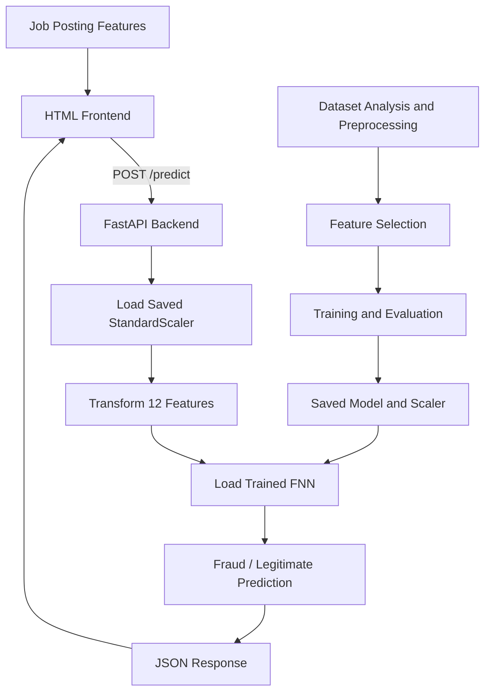

::: {align="center"}
# JobFraud

### Fraudlent Job Posting Detection System

A machine learning web application that analyzes job-posting features
and predicts whether a listing is **potentially fraudulent or
legitimate**.

```{=html}
<p>
```
``{=html}
``{=html}
``{=html}
``{=html}
```{=html}
</p>
```
```{=html}
<p>
```
``{=html}
``{=html}
``{=html}
```{=html}
</p>
```
**[Live Demo](https://isitfraud.me) · [Backend
API](https://spot-scam.onrender.com/predict) · [Docker Hub](https://hub.docker.com/repository/docker/cyber4surfer/detect-fraud/general)**
:::

------------------------------------------------------------------------

## Overview

JobFraud is an end-to-end machine learning project designed to classify
job postings as **fraudulent (class 1)** or **legitimate (class 0)**
based on structured features extracted from a job listing.

The project covers the full path from dataset analysis and feature
selection to model training, evaluation, API development,
containerization, and cloud deployment. A lightweight HTML frontend
sends job-posting information to a FastAPI backend and displays the
model's prediction.

> **Important:** This tool provides a model-based risk indication, not a
> guarantee that a job posting is genuine or fraudulent. Predictions
> should not replace independent verification.

## Live Application

**Try it:** [Open the deployed frontend](https://isitfraud.me)

```{=html}
<!-- Replace this placeholder with a screenshot committed to your repository. -->
```
```{=html}
<p align="center">
```
``{=html}
```{=html}
</p>
```
## Key Features

-   **Binary classification:** estimates whether a job posting belongs
    to the fraudulent or legitimate class.
-   **Data-driven feature selection:** reduced the original 33 features
    to 12 input features using correlation analysis and feature
    relevance.
-   **Model comparison:** trained and evaluated Logistic Regression and
    a Feed-Forward Neural Network (FNN).
-   **Imbalance-aware training:** sampled the training data to create a
    balanced class distribution while keeping the test split separate.
-   **Neural-network regularization:** uses Batch Normalization and
    Dropout to support stable training and generalization.
-   **Prediction API:** serves model predictions through a FastAPI
    `POST /predict` endpoint.
-   **Saved inference artifacts:** stores the trained neural network
    (`.pt`) and fitted `StandardScaler` (`.pkl`).
-   **Containerized backend:** packages the API and its dependencies
    with Docker.
-   **Cloud deployment:** frontend hosted on Netlify and backend
    deployed on Render using a Docker image published to Docker Hub.

## System Architecture



**Deployment flow**

-   **Frontend:** HTML, CSS, and JavaScript hosted on Netlify.
-   **Backend:** FastAPI application packaged in a Docker image and
    deployed on Render.
-   **Image registry:** Docker Hub stores the built backend image.

## Dataset and Preprocessing

The dataset contains structured information about job postings and a
binary target label:

  Label   Meaning
  ------- ------------------------
  `0`     Legitimate job posting
  `1`     Fraudulent job posting

The original dataset was described as containing approximately one
million records, 33 features, and a class distribution of roughly 20%
fraud and 80% legitimate postings.

### Preprocessing workflow

1.  **Explore the original features:** inspected the 33 features and
    their relationships with correlation analysis.
2.  **Select features:** removed unnecessary or less useful features and
    retained 12 model input features plus the target label.
3.  **Split the data:** separated training and test data before applying
    the training-set balancing procedure.
4.  **Balance the training set:** randomly sampled the training data to
    obtain approximately equal numbers of class `0` and class `1`
    examples, then shuffled the result.
5.  **Scale the inputs:** fitted a `StandardScaler` on the training
    features and reused that fitted scaler during inference.
6.  **Keep test data separate:** evaluated the model on the held-out
    test split without applying the training-set balancing operation to
    it.

**Reproducibility note:** reported classification reports show 1,089,258
balanced training examples and 300,000 test examples for the FNN. These
counts do not match a simple 80:20 split of exactly one million rows, so
confirm the final dataset and split counts before publishing a
definitive total. The README intentionally treats the dataset size as
approximate.

### Avoiding data leakage

The scaler should be fitted only on the training data. Any learned
preprocessing, feature selection, and threshold selection should
likewise avoid using the held-out test labels. The test set should be
used for final evaluation, not for tuning the decision threshold.

## Models

Two classification approaches were evaluated.

### 1. Logistic Regression

A baseline model was trained on the balanced training set. It provides a
relatively simple point of comparison for the neural network.

### 2. Feed-Forward Neural Network

The FNN uses three hidden layers and a single output unit for binary
classification.

``` text
Input: 12 features
       |
Linear: 12 → 256
       |
BatchNorm1d + LeakyReLU + Dropout(0.2)
       |
Linear: 256 → 128
       |
BatchNorm1d + LeakyReLU + Dropout(0.1)
       |
Linear: 128 → 64
       |
BatchNorm1d + LeakyReLU + Dropout(0.1)
       |
Linear: 64 → 1
       |
Sigmoid probability
```

  Training setting            Value
  --------------------------- ----------------------------------
  Hidden-layer architecture   `256 → 128 → 64`
  Output                      1 unit for binary classification
  Activation                  Leaky ReLU in hidden layers
  Normalization               `BatchNorm1d`
  Dropout                     `0.2`, `0.1`, `0.1`
  Optimizer                   RMSprop
  Loss                        Binary Cross-Entropy (`BCELoss`)
  Epochs                      30
  Batch size                  1,000
  Input scaling               `StandardScaler`

The model and fitted scaler were saved separately for inference: a
PyTorch `.pt` model file and a `.pkl` scaler file.

## Evaluation Results

The results below reproduce the reported classification metrics. Class
`1` is the fraud class.

### Logistic Regression

  Test metric     Class 0: Legitimate   Class 1: Fraud
  ------------- --------------------- ----------------
  Precision                      0.93             0.52
  Recall                         0.79             0.78
  F1-score                       0.85             0.62

  Overall test metric      Result
  --------------------- ---------
  Accuracy                   0.79
  Macro-average F1           0.74
  Weighted-average F1        0.80
  Test examples           300,000

### Feed-Forward Neural Network

  Test metric     Class 0: Legitimate   Class 1: Fraud
  ------------- --------------------- ----------------
  Precision                      0.92             0.60
  Recall                         0.86             0.73
  F1-score                       0.89             0.66

  Overall test metric      Result
  --------------------- ---------
  Accuracy                   0.83
  Macro-average F1           0.77
  Weighted-average F1        0.84
  Test examples           300,000

### Model comparison

  Test metric         Logistic Regression    FNN
  ----------------- --------------------- ------
  Accuracy                           0.79   0.83
  Fraud precision                    0.52   0.60
  Fraud recall                       0.78   0.73
  Fraud F1-score                     0.62   0.66

On the reported test results, the FNN has higher accuracy, fraud
precision, and fraud F1-score, while Logistic Regression has slightly
higher fraud recall. This is a trade-off: the FNN's predictions for the
fraud class are more precise, but it misses a larger share of fraudulent
postings.

For fraud detection, accuracy alone is not enough. Precision measures
how many postings flagged as fraud are actually fraud; recall measures
how many of the fraudulent postings are found. The appropriate balance
depends on the consequences of false positives and false negatives.

### Precision--Recall analysis 

The training precision--recall analysis reported a score of
approximately **0.89**

-   The training score is not the same as test-set performance.
-   Confirm whether the reported score is average precision or another
    precision--recall summary before labeling it in the final report.
-   The threshold should be selected using a validation set and a
    clearly defined objective, then evaluated once on the held-out test
    set.
-   Because the training data was balanced while the test data retained
    an imbalanced distribution, predicted probabilities and the optimal
    operating threshold may not transfer directly to real-world traffic.

## Tech Stack

  Component                   Technology
  --------------------------- ---------------------------------------
  Language                    Python
  Data analysis               Pandas, NumPy, correlation analysis
  Machine learning baseline   Scikit-learn Logistic Regression
  Deep learning               PyTorch
  Preprocessing               Scikit-learn `StandardScaler`
  API                         FastAPI
  API server                  Uvicorn, if configured in the project
  Serialization               PyTorch `.pt`, Python pickle `.pkl`
  Frontend                    HTML, CSS, JavaScript
  Containerization            Docker
  Image registry              Docker Hub
  Backend hosting             Render
  Frontend hosting            Netlify

## Project Structure

The structure below is a suggested representation. Adjust file and
directory names to match the actual repository.

``` text
JobFraud/
├── backend/
│   ├── main.py                 # FastAPI application
│   ├── model.pt                # Saved FNN weights/model
│   ├── scaler.pkl              # Fitted StandardScaler
│   ├── requirements.txt        # Backend dependencies
│   └── Dockerfile              # Backend container configuration
├── frontend/
│   └── index.html              # User interface
├── docs/
│   ├── demo.png                # Application screenshot
│   └── architecture.png        # Optional architecture image
├── .gitignore
└── README.md
```

Do not commit large datasets, secrets, API keys, or other sensitive
files. If your model artifacts are too large for normal Git hosting,
document how to obtain them.

## Run Locally

These instructions are a starting point; adjust them to match your
actual filenames, Python version, and server configuration.

### 1. Clone the repository

``` bash
git clone https://github.com/Ashthecoder918/Job-Fraud
cd JobFraud
```

### 2. Install backend dependencies

``` bash
cd backend
python -m venv .venv
```

Activate the environment:

**Windows PowerShell**

``` powershell
.venv\Scripts\Activate.ps1
```

**macOS / Linux**

``` bash
source .venv/bin/activate
```

Install the dependencies:

``` bash
pip install -r requirements.txt
```

### 3. Start the FastAPI backend

If the application instance is named `app` in `main.py`, run:

``` bash
uvicorn main:app --reload --host 127.0.0.1 --port 8000
```

Open the interactive API documentation at:

``` text
http://127.0.0.1:8000/docs
```

If your app uses a different module or instance name, update the command
accordingly.

### 4. Open the frontend

Serve the frontend directory with a local HTTP server rather than
opening the HTML file directly:

``` bash
cd ../frontend
python -m http.server 5500
```

Then open `http://localhost:5500` in your browser.

Configure the frontend's API URL to point to the local backend, for
example:

``` text
http://127.0.0.1:8000/predict
```

Ensure the FastAPI CORS configuration permits the local frontend origin.

## API Reference

### `POST /predict`

Accepts the job-posting feature values expected by the trained model and
returns a prediction.

**Example request structure --- replace the placeholder fields with the
exact 12 feature names and data types required by your API:**

``` json
{
  "feature_1": 0,
  "feature_2": 1,
  "feature_3": 0
}
```

**Example response structure --- confirm the exact field name and label
convention in your implementation:**

``` json
{
  "Prediction": 0
}
```

  Prediction   Interpretation
  ------------ ------------------
  `0`          Legitimate class
  `1`          Fraud class

The backend must apply the same feature order and preprocessing used
during training. The request schema above is illustrative, not a
complete, ready-to-run payload.

## Deployment

The application is deployed as two separate components:

1.  **Backend API:** packaged into a Docker image, published to Docker
    Hub, and deployed on Render.
2.  **Frontend:** the single-page HTML interface hosted on Netlify and
    configured to call the deployed backend endpoint.

Before deploying a new model, make sure the model artifact, scaler,
input feature order, API schema, CORS origins, and prediction threshold
are consistent with the training pipeline. Never expose private
credentials in frontend code or commit them to GitHub.

## Limitations and Future Improvements

-   Evaluate the model on a representative, untouched test set and
    report metrics for the real-world class distribution.
-   Validate the probability threshold using a separate validation set.
-   Track precision--recall performance and calibration under changing
    fraud prevalence.
-   Add input validation, clearer API error messages, and automated
    tests.
-   Add model/version tracking and monitoring for data drift.
-   Improve explainability so users can better understand factors
    associated with a prediction.
-   Test the service's latency, memory usage, and behavior under
    concurrent requests.
-   Add more representative data and assess performance across different
    job categories and posting sources.

## Author

**Ashutosh Nayak**

-   GitHub: [Ashthecoder918](https://github.com/Ashthecoder918)
-   LinkedIn: [ashutosh-nayak-90y](https://www.linkedin.com/in/ashutosh-nayak-90y)

------------------------------------------------------------------------

::: {align="center"}
**Built to explore practical machine learning, model evaluation, API
development, and deployment.**
:::
